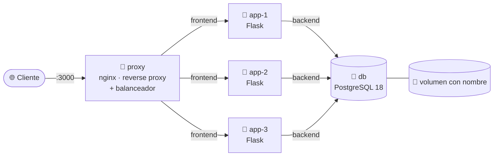
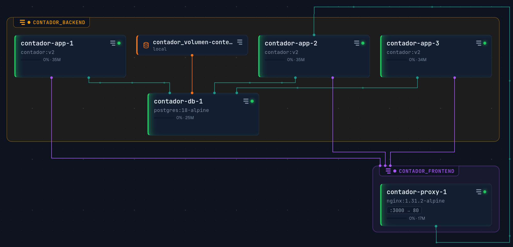

# 🐳 Contador de visitas · Docker Compose estilo producción

[🇬🇧 English](README.md) · [🇪🇸 Español](README.es.md)

Una app Flask mínima que cuenta visitas en PostgreSQL. La app es simple a propósito, para que el foco esté en **la infraestructura que la rodea**: un reverse proxy con balanceo de carga y failover, tres réplicas sin estado, redes aisladas, Docker secrets y un usuario de base de datos con privilegios mínimos.

---

## 🗺️ Arquitectura



- **Una sola entrada:** solo el proxy publica un puerto (`3000`). Las apps y la base no son accesibles desde el host.
- **Dos redes:** `proxy` vive solo en `frontend`, `db` solo en `backend`, y `app` es el único puente entre ambas. El proxy ni siquiera puede resolver el nombre `db`.
- **Apps sin estado:** todo el estado vive en PostgreSQL, así que cualquier réplica puede atender cualquier petición.

### 🔭 Vista en vivo



*Grupos = redes. 🟣 apps conectadas también a `frontend` · 🟢 `depends_on` · 🟠 montaje del volumen. Las líneas muestran dependencias, no tráfico.*

---

## 🧰 Stack

| Componente | Imagen / versión | Rol |
|---|---|---|
| proxy | `nginx:1.31.2-alpine` | Reverse proxy, balanceo round-robin, failover |
| app | `python:3.14-slim` + Flask + psycopg 3 | API sin estado, 3 réplicas, usuario no-root |
| db | `postgres:18-alpine` | Almacenamiento persistente en un volumen con nombre |

---

## 🚀 Puesta en marcha

Requisitos: Docker Engine con el plugin Compose, y `openssl`.

```bash
git clone <url-del-repo>
cd contador

# 1. Generar los secrets (nunca van a Git)
mkdir -p secrets
openssl rand -hex 16 | tr -d '\n' > secrets/db_password.txt       # admin de la base
openssl rand -hex 16 | tr -d '\n' > secrets/db_app_password.txt   # usuario de la app

# 2. Construir y levantar
docker compose up -d --build

# 3. Probar
curl localhost:3000
# {"servidor":"<id-del-contenedor>","visitas":1}
```

En el primer arranque, PostgreSQL ejecuta `initdb/01-init.sql`, que crea la tabla, el usuario de la app y sus permisos. No hace falta escribir SQL a mano.

---

## 📁 Estructura

```
contador/
├── app.py              # app Flask
├── requirements.txt
├── Dockerfile          # imagen con usuario no-root
├── .dockerignore
├── compose.yml         # proxy + app ×3 + db, redes, secrets
├── nginx.conf          # upstream, failover, DNS dinámico
├── initdb/
│   └── 01-init.sql     # esquema + usuario de la app + GRANTs (solo primer arranque)
└── secrets/            # ⚠️ ignorado por Git y Docker
    ├── db_password.txt
    └── db_app_password.txt
```

---

## 🧠 Decisiones de diseño

| Decisión | Por qué |
|---|---|
| **Secrets como archivos** (`*_FILE` → `/run/secrets/...`) en lugar de variables de entorno | Las variables aparecen en `docker inspect`, `env` y logs. Un secret es solo un archivo dentro de los contenedores que lo piden. |
| **La app lee `DB_PASS_FILE`** con fallback a `DB_PASS` | La imagen oficial de Postgres ya soporta `_FILE`; la app adopta el mismo contrato para funcionar con secrets en producción y sin ellos en local. |
| **Dos usuarios de base:** admin (superusuario) + `contador_app` | La app solo necesita `SELECT` y `UPDATE` sobre una tabla. Si la comprometen, no puede borrar datos, crear usuarios ni ejecutar comandos del sistema (`COPY ... FROM PROGRAM`). |
| **El esquema en `initdb/`, no en la app** | Crear tablas es tarea del admin, una sola vez. Un permiso no se puede dar "solo al arrancar", así que la app nunca recibe `CREATE`. |
| **Redes `frontend` / `backend`** | Mínimo privilegio en la capa de red: el proxy, expuesto al exterior, no tiene ruta hacia la base. |
| **Solo el proxy publica un puerto** | Una sola puerta de entrada; todo lo demás es interno. |
| **`zone` + `resolve` + `resolver 127.0.0.11`** en nginx | Round-robin compartido entre workers, y las réplicas se redescubren por el DNS de Docker cuando cambian de IP. |
| **Timeouts cortos + `proxy_next_upstream`** | Si una réplica muere, nginx reintenta en otra en ~2 s en lugar de colgarse 60 s. |
| **`healthcheck` + `depends_on: service_healthy`** | Las apps arrancan cuando PostgreSQL realmente acepta conexiones, no solo cuando su contenedor está corriendo. |
| **Usuario no-root** en la imagen de la app | Un proceso que escape de la app no arranca como root. |
| **`UPDATE ... RETURNING` atómico** | Incrementar y leer en una sola sentencia: no se pierden visitas con 3 réplicas escribiendo a la vez. |
| **`restart: unless-stopped`** | Los contenedores vuelven solos tras una caída o un reinicio. |

---

## ✅ Cómo verificarlo

**Balanceo de carga** — el campo `servidor` cambia en cada petición:

```bash
for i in 1 2 3 4 5 6; do curl -s localhost:3000; echo; done
```

**Failover** — se apaga una réplica y las peticiones siguen funcionando:

```bash
docker stop contador-app-2
for i in 1 2 3 4 5 6; do curl -s localhost:3000; echo; done
docker start contador-app-2
```

**Prueba de carga** con [`hey`](https://github.com/rakyll/hey):

```bash
hey -z 10s -c 50 http://localhost:3000/
```

**Aislamiento de red** — el proxy no ve la base:

```bash
docker compose exec proxy ping -c1 db     # bad address 'db'
```

**La contraseña no aparece en la metadata:**

```bash
docker inspect contador-app-1 | grep -i pass    # solo DB_PASS_FILE=/run/secrets/...
docker compose exec proxy ls /run/secrets/      # No such file or directory
```

**Mínimo privilegio en PostgreSQL:**

```bash
docker compose exec db psql -U contador_app -d db-contador -c "DELETE FROM visitas;"
# ERROR: permission denied for table visitas
```

---

## 🛠️ Operación

| Qué cambió | Comando |
|---|---|
| `compose.yml` | `docker compose up -d` |
| `app.py` o `Dockerfile` | `docker compose up -d --build` |
| `nginx.conf` | validar: `docker compose run --rm --no-deps proxy nginx -t`<br/>aplicar: `docker compose up -d --force-recreate proxy` |
| Apagar sin perder datos | `docker compose down` |
| ⚠️ Apagar **y borrar la base** | `docker compose down -v` |

**Diagnóstico por síntoma:**

| `curl` devuelve | Capa que falla | Dónde mirar |
|---|---|---|
| `Could not connect` (sin código HTTP) | el proxy está caído | `docker compose logs proxy` |
| `502 Bad Gateway` (página de nginx) | las apps están caídas | `docker compose logs app` |
| `500 Internal Server Error` (página de Flask) | la app vive, algo detrás falló | `docker compose logs app` → db |

### 🔄 Rotar la contraseña de la app

PostgreSQL solo lee los archivos de secrets en el **primer** arranque, así que rotar significa cambiarla en los dos lugares, uno pegado al otro:

```bash
NUEVA=$(openssl rand -hex 16)
docker compose exec db psql -U admin -d db-contador -c "ALTER USER contador_app PASSWORD '$NUEVA';" \
  && printf '%s' "$NUEVA" > secrets/db_app_password.txt
unset NUEVA
```

La app lee el archivo en cada conexión, así que toma la contraseña nueva sin reiniciar.

---

## 🚧 Limitaciones conocidas y próximos pasos

- **La base es un punto único de falla.** Tres réplicas de la app no sirven si `db` se cae. En la nube: una base gestionada con réplica en espera (por ejemplo, Amazon RDS Multi-AZ).
- **Sin HTTPS.** Próximo paso: terminación TLS en el proxy.
- **Una conexión por petición.** Suficiente a esta escala; un pool de conexiones sería la siguiente mejora.
- **Todas las réplicas actualizan la misma fila.** Con mucha carga, esa fila se vuelve el cuello de botella.
- **Sin healthcheck en la app.** nginx detecta réplicas caídas cuando fallan las peticiones, no antes.

---

## 📚 Qué aprendí

- **Las redes de Docker por fin me hicieron clic.** Los contenedores se encuentran por nombre de servicio gracias al DNS interno de Docker, no por IP. Y aislar es tan importante como conectar: el proxy ni siquiera puede resolver `db`, porque no comparten red.
- **Una ruta no es su contenido.** El bug que más me enseñó fue pasar la *ruta* del secret como contraseña en lugar de *leer el archivo*. La app mandaba `/run/secrets/...` como contraseña y Postgres la rechazaba. Ahora siempre me pregunto: ¿esto necesita la ubicación o lo que hay adentro?
- **Las pruebas de carga y failover hicieron real la alta disponibilidad.** Ver a `hey` mandar cientos de peticiones por segundo, apagar una réplica y obtener cero errores después de ajustar los timeouts de nginx me enseñó más que cualquier definición.
- **Leer los logs, no adivinar.** `docker compose ps -a` y `docker compose logs` me dijeron qué fallaba cada vez, más rápido que cualquier teoría mía.
