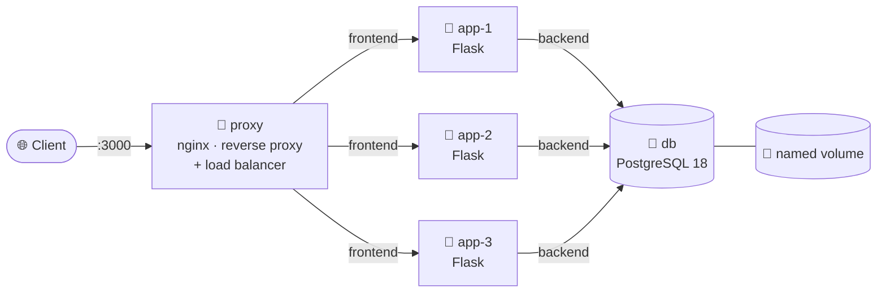
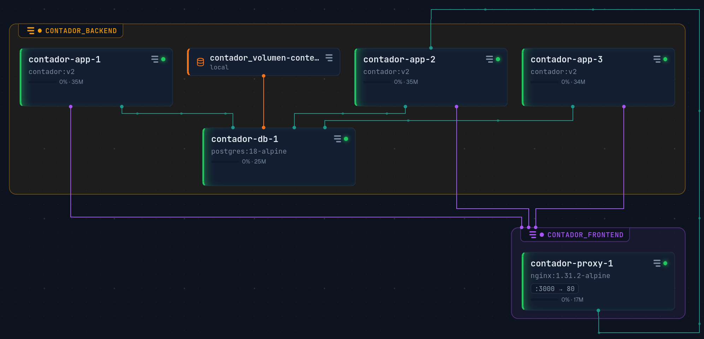

# 🐳 Visit Counter · Production-style Docker Compose

[🇬🇧 English](README.md) · [🇪🇸 Español](README.es.md)

A tiny Flask app that counts visits in PostgreSQL. The app is deliberately simple so the focus stays on the **infrastructure around it**: a reverse proxy with load balancing and failover, three stateless replicas, isolated networks, Docker secrets, and a least-privilege database user.

---

## 🗺️ Architecture



- **Single entry point:** only the proxy publishes a port (`3000`). The apps and the database are not reachable from the host.
- **Two networks:** `proxy` lives only in `frontend`, `db` only in `backend`, and `app` is the only bridge between them. The proxy can't even resolve the name `db`.
- **Stateless apps:** all state lives in PostgreSQL, so any replica can serve any request.

### 🔭 Live view



*Groups = networks. 🟣 apps also attached to `frontend` · 🟢 `depends_on` · 🟠 volume mount. Lines show dependencies, not traffic.*

---

## 🧰 Stack

| Component | Image / version | Role |
|---|---|---|
| proxy | `nginx:1.31.2-alpine` | Reverse proxy, round-robin load balancing, failover |
| app | `python:3.14-slim` + Flask + psycopg 3 | Stateless API, 3 replicas, non-root user |
| db | `postgres:18-alpine` | Persistent storage in a named volume |

---

## 🚀 Quick start

Requirements: Docker Engine with the Compose plugin, and `openssl`.

```bash
git clone <repo-url>
cd contador

# 1. Generate the secrets (they never go to Git)
mkdir -p secrets
openssl rand -hex 16 | tr -d '\n' > secrets/db_password.txt       # DB admin
openssl rand -hex 16 | tr -d '\n' > secrets/db_app_password.txt   # app user

# 2. Build and start
docker compose up -d --build

# 3. Try it
curl localhost:3000
# {"servidor":"<container-id>","visitas":1}
```

On the first start, PostgreSQL runs `initdb/01-init.sql`, which creates the table, the app user and its permissions. No manual SQL needed.

---

## 📁 Project structure

```
contador/
├── app.py              # Flask app
├── requirements.txt
├── Dockerfile          # non-root image
├── .dockerignore
├── compose.yml         # proxy + app ×3 + db, networks, secrets
├── nginx.conf          # upstream, failover, dynamic DNS
├── initdb/
│   └── 01-init.sql     # schema + app user + GRANTs (first start only)
└── secrets/            # ⚠️ ignored by Git and Docker
    ├── db_password.txt
    └── db_app_password.txt
```

---

## 🧠 Design decisions

| Decision | Why |
|---|---|
| **Secrets as files** (`*_FILE` → `/run/secrets/...`) instead of env vars | Environment variables show up in `docker inspect`, `env` and logs. A secret is only a file inside the containers that request it. |
| **The app reads `DB_PASS_FILE`** with a fallback to `DB_PASS` | The official Postgres image already supports `_FILE`; the app got the same contract so it works with secrets in production and without them locally. |
| **Two DB users:** admin (superuser) + `contador_app` | The app only needs `SELECT` and `UPDATE` on one table. If it is compromised, it can't delete data, create users or run OS commands (`COPY ... FROM PROGRAM`). |
| **Schema in `initdb/`, not in the app** | Creating tables is a one-time admin task. A permission can't be granted "only at startup", so the app never gets `CREATE`. |
| **`frontend` / `backend` networks** | Least privilege at the network layer: the public-facing proxy has no route to the database. |
| **Only the proxy publishes a port** | One entry point; everything else is internal. |
| **`zone` + `resolve` + `resolver 127.0.0.11`** in nginx | Shared round-robin across workers, and replicas are re-discovered through Docker's DNS when they change IP. |
| **Short timeouts + `proxy_next_upstream`** | If a replica dies, nginx retries on another one in ~2 s instead of hanging for 60 s. |
| **`healthcheck` + `depends_on: service_healthy`** | The apps start only when PostgreSQL actually accepts connections, not just when its container is running. |
| **Non-root user** in the app image | A process escaping the app doesn't start as root. |
| **Atomic `UPDATE ... RETURNING`** | Increment and read in one statement: no lost visits with 3 replicas writing at once. |
| **`restart: unless-stopped`** | Containers come back after a crash or a reboot. |

---

## ✅ How to verify it

**Load balancing** — the `servidor` field changes on each request:

```bash
for i in 1 2 3 4 5 6; do curl -s localhost:3000; echo; done
```

**Failover** — stop one replica and keep sending requests; they still succeed:

```bash
docker stop contador-app-2
for i in 1 2 3 4 5 6; do curl -s localhost:3000; echo; done
docker start contador-app-2
```

**Load test** with [`hey`](https://github.com/rakyll/hey):

```bash
hey -z 10s -c 50 http://localhost:3000/
```

**Network isolation** — the proxy can't see the database:

```bash
docker compose exec proxy ping -c1 db     # bad address 'db'
```

**No password in the metadata:**

```bash
docker inspect contador-app-1 | grep -i pass    # only DB_PASS_FILE=/run/secrets/...
docker compose exec proxy ls /run/secrets/      # No such file or directory
```

**Least privilege in PostgreSQL:**

```bash
docker compose exec db psql -U contador_app -d db-contador -c "DELETE FROM visitas;"
# ERROR: permission denied for table visitas
```

---

## 🛠️ Operations

| What changed | Command |
|---|---|
| `compose.yml` | `docker compose up -d` |
| `app.py` or `Dockerfile` | `docker compose up -d --build` |
| `nginx.conf` | validate: `docker compose run --rm --no-deps proxy nginx -t`<br/>apply: `docker compose up -d --force-recreate proxy` |
| Stop without losing data | `docker compose down` |
| ⚠️ Stop **and delete the database** | `docker compose down -v` |

**Troubleshooting by symptom:**

| `curl` returns | Failing layer | Look at |
|---|---|---|
| `Could not connect` (no HTTP code) | proxy is down | `docker compose logs proxy` |
| `502 Bad Gateway` (nginx page) | apps are down | `docker compose logs app` |
| `500 Internal Server Error` (Flask page) | app is up, something behind it failed | `docker compose logs app` → db |

### 🔄 Rotating the app password

PostgreSQL only reads the secret files on the **first** start, so rotating means changing it in both places, back to back:

```bash
NEW=$(openssl rand -hex 16)
docker compose exec db psql -U <admin-user> -d db-contador -c "ALTER USER contador_app PASSWORD '$NEW';" \
  && printf '%s' "$NEW" > secrets/db_app_password.txt
unset NEW
```

The app reads the file on every connection, so it picks up the new password without a restart.

---

## 🚧 Known limitations and next steps

- **The database is a single point of failure.** Three app replicas don't help if `db` goes down. In the cloud: a managed database with a standby replica (e.g. Amazon RDS Multi-AZ).
- **No HTTPS.** Next step: TLS termination in the proxy.
- **One connection per request.** Fine for this scale; a connection pool would be the next improvement.
- **All replicas update the same row.** Under heavy load, that row becomes the bottleneck.
- **No healthcheck on the app.** nginx detects dead replicas by failing requests, not in advance.

---

## 📚 What I learned

- **Docker networking finally clicked.** Containers find each other by service name through Docker's internal DNS, not by IP. And isolation is just as important as connectivity: the proxy can't even resolve `db` because they don't share a network.
- **A path is not its content.** My most instructive bug was passing the secret's *path* as the password instead of *reading the file*. The app got `/run/secrets/...` as a password and Postgres rejected it. Now I always ask: does this need the location, or what's inside it?
- **Load and failover testing made HA real.** Watching `hey` push hundreds of requests per second, then stopping a replica and seeing zero errors after tuning nginx timeouts, taught me more than any definition of "high availability".
- **Read the logs, don't guess.** `docker compose ps -a` and `docker compose logs` told me what was wrong every single time, faster than any theory I came up with.
